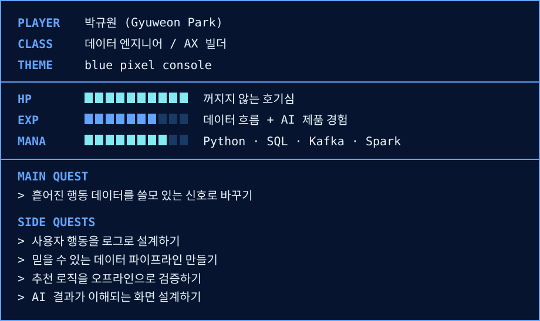

  
  
  

<code>▣ ▣ ▣  build data flows · design AI experiences · validate what ships  ▣ ▣ ▣</code>

### >_ Now Playing

<code>◆◇◆</code>

### >_ 소개

데이터 흐름과 AI 기능을 서비스로 구현하는 개발자입니다.
원천 데이터와 사용자 행동을 바탕으로 데이터 파이프라인과 추천 로직, AI 기반 사용자 경험을 만듭니다.

- `focus` **데이터 엔지니어링, 데이터 모델링, 추천 시스템, AX**
- `contact` rbdnjs9@gmail.com / rbdnjs7034@naver.com
- `linkedin` [Gyuweon Park](https://www.linkedin.com/in/gyuweon-park/)

<code>◆◇◆</code>

### >_ Mini Quest Board

<code>◆◇◆</code>

### >_ 기술 스택

**언어 · 기본** 

**백엔드 · 프레임워크** 

**프론트엔드 · AX** 

**데이터 · 스트리밍** 

**DB · OS · 도구** 

<code>◆◇◆</code>

### >_ 대표 프로젝트

#### [01] [화분 HWABUN | 뷰티 커머스 추천·분석 플랫폼](https://github.com/ParkGyuweon/hwabun)

> 2026.08 - 2026.10 · 6인 팀 · AI·추천 / 데이터 시뮬레이션

행동 로그를 수집·분석해 개인화 추천과 브랜드 대시보드로 연결하는 뷰티 커머스 플랫폼입니다.

- 148차원 상품 벡터와 CBF·CF·LTR을 결합한 추천 모델, FastAPI 추천 서버 구현
- 페르소나 9,900명 기반 합성 로그 약 1,049만 건 생성, Kafka 소비 처리량을 로컬 초당 1,000건에서 약 35,000건으로 개선
- 상품·피처 계약과 데이터마트 발행 검증을 보완하고, 산출물 재생성 경로와 연계 구조를 문서화

#### [02] [털뭉치로드 | AI 기반 반려동물 동반 장소 추천](https://github.com/ParkGyuweon/the_fluff_road)

반려동물 동반 장소를 지도에서 찾고, 이용 이력에 맞춰 추천받는 서비스입니다.

- 시설 208곳의 데이터와 좋아요·저장 이력을 활용하는 Django·DRF 추천 API 구현
- LLM이 반환한 장소 ID를 후보 목록과 대조하고, 호출·파싱 실패 시 규칙 기반 추천으로 대체

#### [03] [빵긋 bbanggeut | 모션 인식 놀이·부모 리포트](https://github.com/ParkGyuweon/bbanggeut)

웹캠 기반 모션 인식 놀이와 아이 일기, 부모 리포트를 연결하는 서비스입니다.

- Figma UI/UX 설계와 React·TypeScript 기반 아이·부모 화면 및 API 연동 담당
- 낱말 맞추기와 숲 속 청소하기 2종 게임을 구현하고, 프론트엔드 QA로 팀의 4종 게임 통합에 기여

#### [04] [multithreaded-http-proxy | HTTP 프록시 서버](https://github.com/ParkGyuweon/multithreaded-http-proxy)

Python 소켓과 스레드로 여러 클라이언트의 HTTP 요청을 중계하는 서버입니다.

- 동시 연결 처리, HTTP 요청 파싱·헤더 재작성·응답 전달 구현
- URL 리다이렉션과 이미지 필터링, 스레드 간 동기화된 요청·응답 로깅 지원

<code>◆◇◆</code>

### >_ 알고리즘

  

<code>◆◇◆</code>

### >_ 자격증

- **2026.09.** 정보처리기사
- **2026.04.** 삼성 SW 역량테스트 A+
- **2026.03.** SQL 개발자(SQLD)
- **2026.01.** SW 코딩 자격

<code>◆◇◆</code>

### >_ 수상

- **2026.09.** SSAFY 특화 프로젝트(화분) 우수상 · 반 1위
- **2026.06.** SSAFY 1학기 성적 우수상 · 서울 3반 1위
- **2026.02.** 연세대학교 우수학업상
- **2023.02.** 연세대학교 우수학업상
- **2022.08.** 연세대학교 우수학업상

<code>◆◇◆</code>

### >_ 어학

- **2025.09.** OPIc(영어) IM2
- **2025.08.** TOEIC 855

